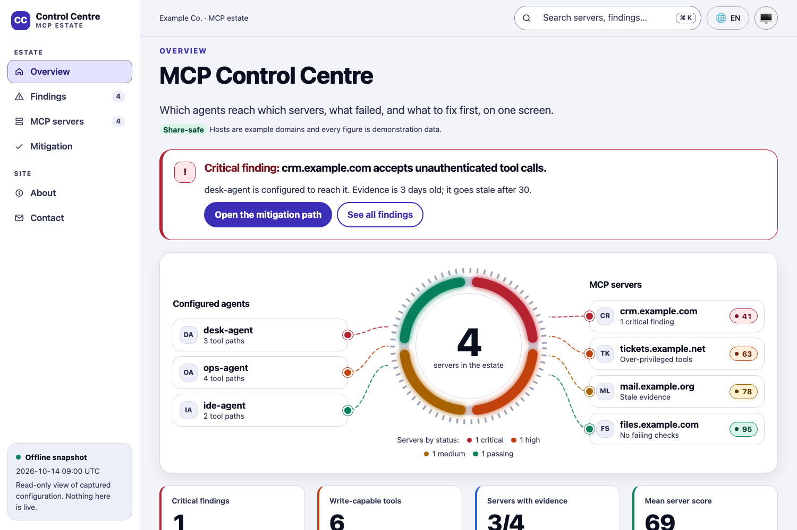

# Control Centre

Control Centre is an operations and security dashboard theme for Static Site
Generator. It lays a report out as an app: a sidebar of destinations, a top
bar with search and the colour mode, a critical-finding banner, a status ring
joined by flows to the systems either side, KPI tiles, and panels for
findings, steps and tables with a five-level severity palette.



The demonstration data is the MCP estate of Example Co., a fictional company:
three agents, four servers on example domains, and invented findings and
scores. Replace all of it before you publish.

## Build

From the repository root:

```sh
ssg build -f themes/control-centre/ssg.toml
```

## Layouts

| Layout | Used by | What it renders |
| --- | --- | --- |
| `index` | `content/index.md` | Intro, alert banner, status ring with lists and flows, KPI tiles, then the Markdown body as dashboard panels |
| `page` | `content/about.md` | Intro and the Markdown body in one panel |
| `contact` | `content/contact.md` | Intro, Markdown body and a contact form |
| `404` | `content/404.md` | Not-found message with a link back to the overview |

`base.html` is the only document shell; `header.html` emits the top bar and
the sidebar, and `footer.html` the footer.

## Data

Every word on a page comes from its front matter or its Markdown body, so the
English and French pages share one set of layouts.

- **Ring.** `ring_value` and `ring_caption` sit in the centre. Each of the
  four arcs takes `ring_N_sev`, `ring_N_count`, `ring_N_label`, and its
  geometry on a 100-unit circle: `ring_N_dash` (length) and `ring_N_offset`
  (start).
- **Lists.** Three agents (`client_N_name`, `client_N_meta`, `client_N_mark`,
  `client_N_sev`) and four servers (the same fields as `server_N_*`, plus
  `server_N_score`). On wide screens `main.js` draws a flow from each entry to
  the ring in the entry's severity colour; below 64rem the lists stack and the
  flows are not drawn.
- **KPI tiles.** `kpi_N_label`, `kpi_N_value`, `kpi_N_note` and `kpi_N_sev`
  for N = 1 to 4.
- **Panels.** The Markdown body of the overview. Wrap a panel in
  `<section class="cc-panel cc-span-7">` (or `cc-span-5`, `cc-span-12`),
  put tables in `<div class="cc-table" role="region" tabindex="0">`, and
  write a severity as `<span class="pill sev-high">High</span>`.

Severity classes are `sev-critical`, `sev-high`, `sev-medium`, `sev-low` and
`sev-ok`. Each sets a solid colour (dots, arcs, flows) and a tint and ink
pair (pills); the words always appear beside the colour.

## Search

The header search field hands its query to the search dialog SSG injects, so
there is one index and one result list, and takes the place of the
generator's floating search button (`main.js` detaches it; Cmd+K and Ctrl+K
still open the dialog). The field stays hidden when that dialog is absent
or JavaScript is off.

## Accessibility and resilience

- WCAG 2.2 AAA colour-token targets in light and dark schemes, including
  every severity pair
- 44-by-44-pixel controls and visible keyboard focus
- tables in labelled, keyboard-scrollable regions
- reduced-motion, forced-colour, print, no-JavaScript and no-CSS fallbacks
- same-origin content security policy and no third-party requests

Automated checks are evidence for the tested pages and environments, not a
permanent certification. Re-run the repository gates after changing content or
colours.

## Security

Every page carries one Content Security Policy, declared in
`_layouts/base.html` and identical across all themes in this suite:

```
default-src 'self'; base-uri 'none'; object-src 'none';
script-src 'self'; style-src 'self'; img-src 'self' data:;
font-src 'self'; connect-src 'self'; manifest-src 'self';
form-action 'self' {form_origin}
```

No inline script or inline style is used: the ring's arcs are SVG
presentation attributes, and the flows are drawn with DOM calls from
`main.js`. Nothing loads from a third-party origin.

The contact page's form posts to `form_action`, and `form_origin` is the
origin the policy allows it to post to. Both default to placeholders on
`https://example.com`. Point them at your own form endpoint before you deploy,
or the browser blocks the POST.

## Credits

The visual language (sidebar shell, status ring with flows, severity palette)
follows the dashboard of passmcp-graph v0.0.7. This theme is a separate
implementation on the Skeletonic Stylus 3.0.0 core; no markup is shared.

## Licence

MIT.
